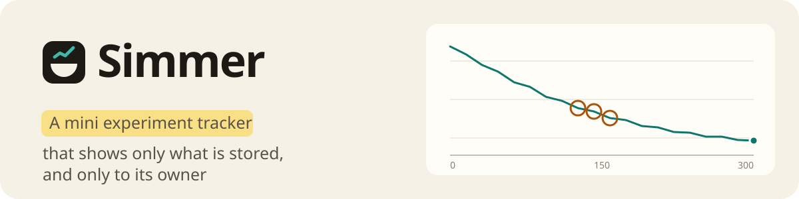
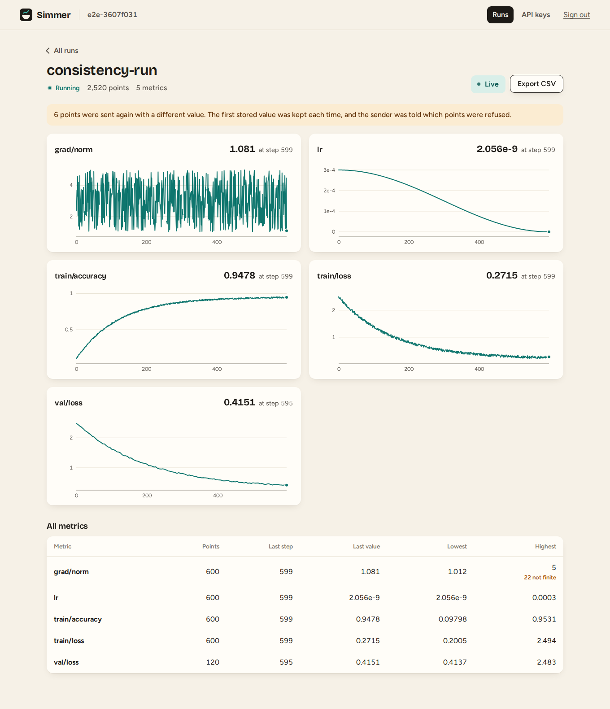
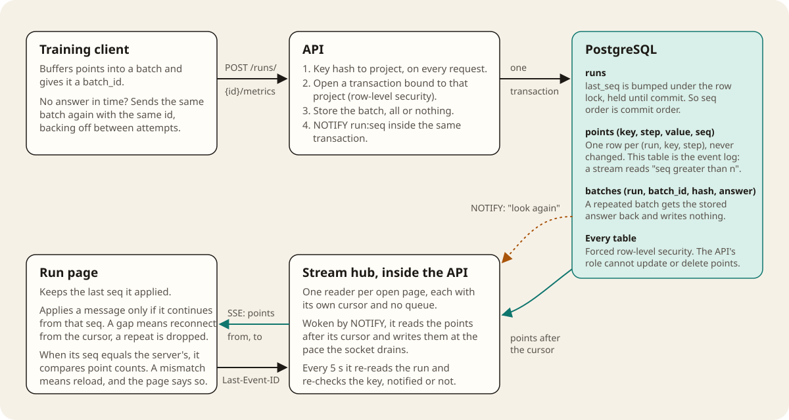

# Simmer

Take-home task for the Soup Full-Stack Engineer internship. Training scripts send metrics in batches over a network that loses, repeats and reorders them. A web page draws each run live. The work is built around the two questions in the task: does the page always match what is stored, and does a project see only its own data.

| Read this | For |
| --- | --- |
| [docs/DESIGN.md](docs/DESIGN.md) | The one-page design, written and committed before the code |
| [docs/NOTE.md](docs/NOTE.md) | The two-page note: proofs, silent failures, verdict, what surprised me, how AI was used |
| [docs/evidence/](docs/evidence/) | Raw, unedited output of every test and load run quoted in the note |

## Run it

```bash
docker compose up --build
```

Open http://localhost:8080, create a project, and press **Send a sample run**. The browser posts 300 training steps over 30 seconds through the public API, with some batches held back, sent twice and out of order, and the run page draws them as they are stored.

The API is also on http://localhost:3000, so the path from the task works as written: `POST http://localhost:3000/runs/{id}/metrics`. Ports can be moved with `WEB_PORT` and `API_PORT`.



## Run the tests

The tests need a second compose file. It turns on fault injection in the API, exposes the database to the tests, and adds the test runner (API tests, then browser tests in Chromium).

```bash
docker compose -f docker-compose.yml -f docker-compose.test.yml up -d --build
```

```bash
docker compose -f docker-compose.yml -f docker-compose.test.yml --profile test run --rm tests
```

Output is printed and also written to `docs/evidence/`. The consistency test is seeded. To repeat it with another seed, add `-e SEED=7` after `run --rm`.

Load test (50 runs, 10 points per second each, two live viewers per run, 60 seconds) and the timing measurement:

```bash
docker compose -f docker-compose.yml -f docker-compose.test.yml --profile test run --rm tests npx tsx load/load.ts
```

```bash
docker compose -f docker-compose.yml -f docker-compose.test.yml --profile test run --rm tests npx tsx load/timing.ts
```

Fault injection exists only when `TEST_HOOKS=1`, which only the test compose file sets.

## How it works



Three decisions carry most of the weight.

**Two orders, kept apart.** The client chooses `step`, and charts are drawn by step, so arrival order cannot change a chart. The server assigns `seq`, one per stored batch, under a lock on the run row that is held until commit. Within a run, `seq` order is therefore commit order, and a reader that has seen batch 41 can never later find out that batch 40 existed.

**The points table is the event log.** Each point stores the `seq` that introduced it. The first load of a page, a reconnect after 30 seconds offline and normal live delivery are the same query, "points of this run after seq n", with a different n. There is no snapshot that could disagree with the stream.

**The database enforces the tenant boundary.** Every query runs in a transaction bound to one project, row-level security is forced on every table, and the API connects as a role that owns nothing and cannot update or delete a stored point. A handler that forgets a `WHERE` returns nothing from another project.

## API

All requests except creating a project carry `Authorization: Bearer sk_…`.

| Request | What it does |
| --- | --- |
| `POST /projects` `{name}` | Creates a project and its first key. The key is shown once |
| `GET /keys`, `POST /keys`, `POST /keys/{id}/rotate`, `DELETE /keys/{id}` | Key management. Rotation replaces a key in one transaction |
| `POST /runs` `{name}`, `GET /runs`, `GET /runs/{id}`, `POST /runs/{id}/finish` | Runs |
| `POST /runs/{id}/metrics` | Stores a batch: `{batch_id, points: [{key, step, value}]}`, up to 1000 points |
| `GET /runs/{id}/metrics?after=` | Stored points after a cursor, as JSON pages |
| `GET /runs/{id}/events` | The live stream (SSE). Resume with `Last-Event-ID` or `?after=` |

The answer to a batch says what happened to it:

```json
{ "batch_id": "6f1c…", "seq": 42, "accepted": 8, "duplicates": 2, "conflicts": [], "replayed": false }
```

`value` is a JSON number, or one of the strings `"NaN"`, `"Infinity"`, `"-Infinity"`. A loss that diverges is exactly when a tracker should not drop data, and JSON cannot carry those values as numbers.

## Layout

| Path | Contents |
| --- | --- |
| `sdk/` | Wire protocol, the ingest client with retries, the stream client, and the reducer that turns stream messages into a run's state. The web page and the tests share it |
| `server/` | Fastify API. `ingest.ts` stores a batch, `hub.ts` serves streams, `schema.ts` holds the tables and policies, `db.ts` binds a transaction to a project |
| `web/` | React app: connect, runs list, live run page, API keys. Charts are hand-written SVG |
| `tests/api/` | Ingestion, streams, isolation, key rotation, crash recovery |
| `tests/e2e/` | Browser tests behind a fault-injecting proxy |
| `tests/load/` | Load test and timing measurement |
| `tests/lib/chaos.ts` | The proxy that drops requests, drops answers, delays, and cuts streams |
